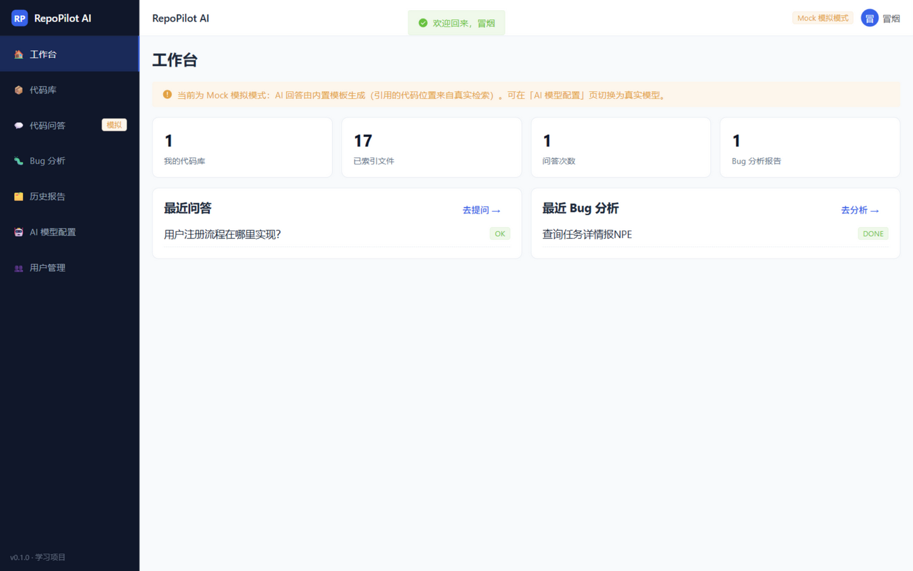
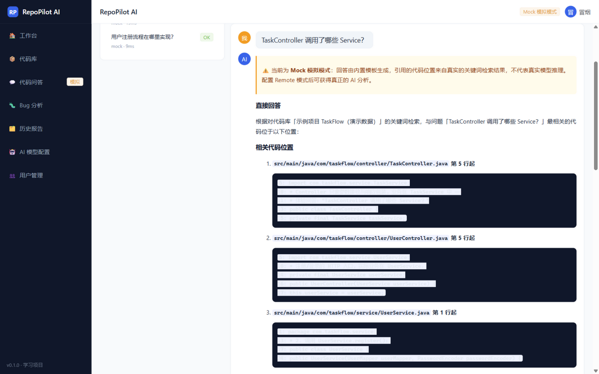
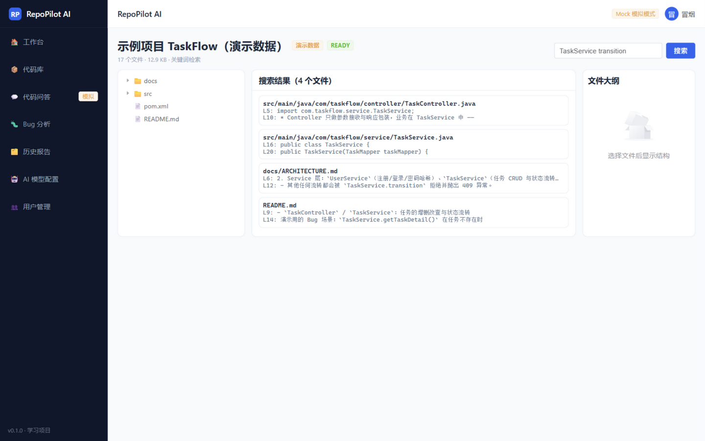
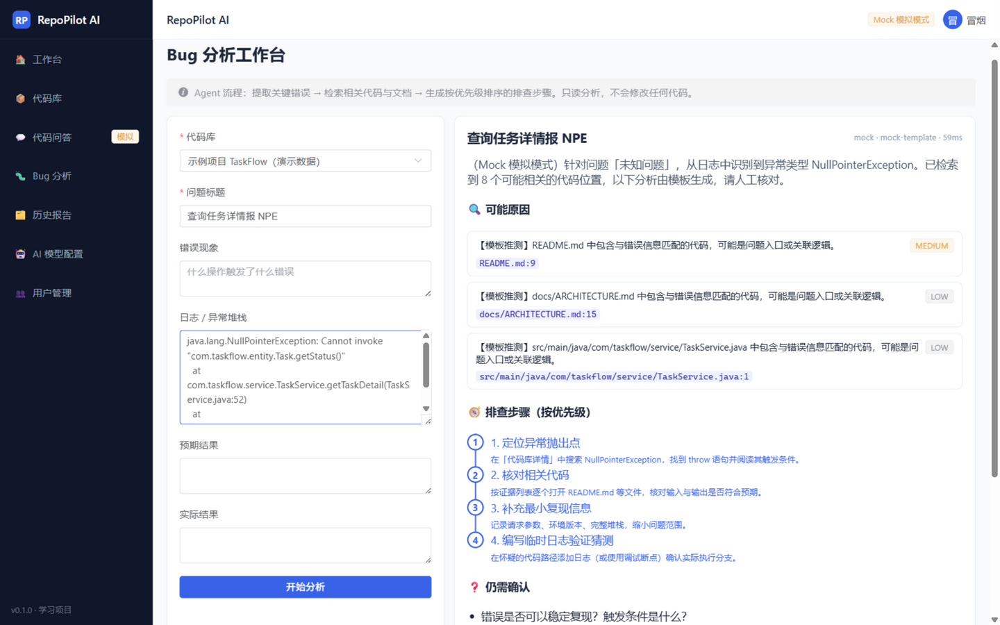

<div align="center">

# RepoPilot AI

**代码库知识问答与 Bug 分析 Agent** —— 帮开发者理解陌生代码库、定位实现、排查 Bug，并给出**可核对依据**的分析报告。

Java 21 · Spring Boot 3.3 · MyBatis-Plus · MySQL 8 / H2 · Vue 3 · TypeScript · Element Plus

[快速开始](#-快速开始) · [功能总览](#-功能总览) · [架构](#-系统架构) · [Mock 演示流程](#-mock-模式演示流程) · [配置真实模型](#-配置真实-ai-模型) · [文档目录](#-文档)

English: RepoPilot AI is a full-stack (Java 21 + Spring Boot 3 + Vue 3) RAG-style agent for codebase Q&A and bug analysis. It imports a repository ZIP, builds a keyword-search index, retrieves evidence first, then asks an AI provider (mock or any OpenAI-compatible remote model) to answer with file/line citations — and never lets the AI touch your code.

</div>

---

## 📸 界面预览（真实运行截图）

| 工作台 | 代码问答（引用证据） |
| --- | --- |
|  |  |
| **代码库检索与文件浏览** | **Bug 分析工作台** |
|  |  |

> 以上截图来自本机实际运行的系统（H2 演示模式 + 内置示例项目），未做任何修饰。

## ✨ 功能总览

- **代码库导入**：上传 ZIP（或一键导入内置示例项目）→ 自动过滤 `.git`/`node_modules`/`target`/密钥文件/二进制 → 后台建立索引；支持查看文件树、代码内容（语法高亮）、文件结构大纲、重建索引、删除。
- **代码问答（RAG）**：先关键词检索出相关代码 → 把**有限且相关**的上下文交给 AI → 回答附带**文件路径 + 行号 + 代码片段**的证据卡片；检索不到依据时如实回答"无法确定"，不编造。
- **Bug 分析 Agent**：输入标题/现象/堆栈/预期/实际 → 流水线自动完成：提取异常类名与堆栈帧 → 多轮检索代码与文档 → 生成结构化报告（可能原因 + 置信度 + 证据、按优先级排序的排查步骤、仍需确认的问题、测试建议）。
- **Agent 工具白名单**：`searchCode` / `readFile` / `getFileOutline` / `searchDocuments` / `analyzeIssue` 五个只读工具，全部由后端权限控制、参数校验、调用次数限额，**每次调用留痕**（tool_call_log）；Agent 只读不写，绝不执行导入项目中的任何代码。
- **历史与审计**：问答记录、Bug 报告、工具调用日志全部持久化，可回看。
- **AI 双模式**：`mock`（零配置演示，诚实标注）与 `remote`（OpenAI 兼容接口：OpenAI / DeepSeek / GLM / 通义等），带超时、重试、失败降级。
- **认证与权限**：注册/登录、BCrypt 密码哈希、JWT、代码库所有权检查（后端强制）、管理员用户管理。

## 🧰 技术栈与实际版本

| 层 | 技术 | 版本（实际验证） |
| --- | --- | --- |
| 语言 | Java | **21.0.11**（JetBrains Runtime；本机编译与 CI 均为 21） |
| 后端框架 | Spring Boot（Web / Security / Validation） | **3.3.5** |
| ORM | MyBatis-Plus（spring-boot3-starter） | 3.5.7 |
| 数据库 | MySQL 8（生产）/ H2（演示与测试） | MySQL 8.0.34 / H2 2.x |
| 认证 | Spring Security + JJWT | jjwt 0.12.6 |
| API 文档 | springdoc-openapi (Swagger UI) | 2.6.0 |
| ZIP 安全 | Apache Commons Compress + 自研校验 | 1.27.1 |
| 前端 | Vue 3 + TypeScript + Vite | Vue 3.5 / TS 5.6 / Vite 6.4 |
| UI | Element Plus | 2.9.x |
| 状态/路由 | Pinia / Vue Router | 2.3 / 4.5 |
| 测试 | JUnit 5 + Spring Boot Test（MockMvc） | 随 Boot BOM |
| AI 接入 | 自研 AiProvider 适配层（OpenAI 兼容 HTTP） | — |

> 说明：AI 层采用"兼容的模型适配层"实现（`AiProvider` 接口 + Mock/Remote 两个实现），未直接依赖 Spring AI，便于理解与替换；语义检索（Embedding/向量库）在路线图中，**当前未实现也不会假装实现**。

## 🏗️ 系统架构

```
┌────────────────────────────── 前端 Vue 3 + TS (localhost:5173) ─────────────────────────────┐
│  Dashboard │ 代码库列表 │ 文件浏览/检索 │ 代码问答(对话+证据分栏) │ Bug分析 │ 历史 │ 模型配置 │ 用户管理 │
└──────────────────────────────────────────┬──────────────────────────────────────────────────┘
                                           │ axios /api（Vite 代理 → 8080）
┌──────────────────────────────────────────▼──────────────────────────────────────────────────┐
│                                 Spring Boot 3 后端 (localhost:8080)                          │
│                                                                                              │
│  Controller 层   AuthController · RepoController · QaController · BugAnalysisController       │
│                  AiConfigController · DashboardController · UserController(ADMIN)             │
│       │                                                                                      │
│  Service 层      AuthService        RepoService          QaService      BugAnalysisService    │
│       │          │                  │                   │              │(Agent 流水线)         │
│       │          │                  │                   │        ┌─────┴──────┐               │
│       │          │                  ▼                   ▼        ▼  ToolRegistry(白名单/预算) │
│       │          │           ZipImporter(安全解压)   KeywordSearch ── 5 个只读工具             │
│       │          │           IndexService(索引)      Service(检索)   (searchCode/readFile/…)   │
│       │          ▼                  │                   │              │                   │
│       │     JwtService/JwtAuthFilter│                   ▼              ▼                   │
│       │                             │            EvidenceFactory   ErrorInfoExtractor      │
│       │                             │                   │              │                   │
│       │                             │                   ▼              ▼                   │
│       │                             │            ┌── AiProviderRegistry ──┐                 │
│       │                             │            │ MockAiProvider │ RemoteAiProvider │       │
│       │                             │            └────────────────┴───(OpenAI兼容 HTTP)──┘    │
│  Mapper 层       UserMapper · RepoMapper · FileIndexMapper · QaRecordMapper ·                │
│                  BugReportMapper · ToolCallLogMapper                (MyBatis-Plus)            │
└──────────────────────────────────────────┬───────────────────────────────────────────────────┘
                                           │
                            ┌──────────────▼───────────────┐
                            │  MySQL 8（生产） / H2（演示）  │
                            │  sys_user · repo · file_index │
                            │  qa_record · bug_report ·     │
                            │  tool_call_log                │
                            └───────────────────────────────┘
```

完整调用链讲解（Vue 页面 → API → Controller → Service → 检索 → AI → 持久化 → 回到页面）见 **[docs/LEARNING_GUIDE.md](docs/LEARNING_GUIDE.md)**。

## 🚀 快速开始

### 环境要求

- JDK 21（`java -version` 确认）
- Maven 3.9+
- Node.js 20+（本机验证用的是 Node 24）
- 数据库二选一：MySQL 8（推荐）**或**什么都不装（H2 演示模式）

### 方式一：H2 零配置演示模式（最快）

```bash
# 1. 构建后端
cd backend
mvn clean package -DskipTests

# 2. 启动后端（H2 模式，自动建表，数据存 ./data/）
java -jar target/repopilot-backend-0.1.0.jar --spring.profiles.active=h2

# 3. 另开一个终端，启动前端
cd frontend
npm install
npm run dev
```

打开 http://localhost:5173 → 注册账号（第一个注册的用户自动成为管理员）→ 登录。

### 方式二：MySQL 8

```bash
# 1. 建库（或用 docker compose up -d 一键起 MySQL 并自动执行建表脚本）
mysql -u root -p < backend/src/main/resources/db/schema-mysql.sql

# 2. 用环境变量提供连接信息后启动后端
cd backend
mvn clean package -DskipTests
java -jar target/repopilot-backend-0.1.0.jar \
  --REPOPILOT_DB_USERNAME=root \
  --REPOPILOT_DB_PASSWORD=你的密码
# 或 export REPOPILOT_DB_PASSWORD=... 后直接 java -jar ...

# 3. 前端同上
```

- Swagger 接口文档：http://localhost:8080/swagger-ui.html
- 前端开发服务器默认端口 5173，`/api` 自动代理到 8080；后端 CORS 已放行 localhost 任意端口。

## 🎬 Mock 模式演示流程

1. **登录**后进入「代码库」→ 点击 **「导入示例项目（演示数据）」**；
2. 等状态变为 **READY**（内置 TaskFlow 示例项目，17 个文件，几秒完成）；
3. 进入「**代码问答**」→ 选择示例库 → 提问试试：
   - `用户注册流程在哪里实现？`
   - `TaskController 调用了哪些 Service？`
   - `任务的 setStatus 状态是如何流转的？`
   - `数据库连接参数配置在哪里？`
   回答右侧/下方会展示**证据卡片**（文件路径 + 行号 + 片段），点击「代码库详情」可核对原文；
4. 进入「**Bug 分析**」→ 把下面的堆栈贴进日志框，标题随意（例如 `查询任务详情报 NPE`）→ 开始分析：

   ```text
   java.lang.NullPointerException: Cannot invoke "com.taskflow.entity.Task.getStatus()"
     at com.taskflow.service.TaskService.getTaskDetail(TaskService.java:52)
     at com.taskflow.controller.TaskController.getTask(TaskController.java:38)
   ```

   报告会引用 TaskService.java 并给出排查步骤（示例项目里故意埋了一个"任务不存在未判空"的缺陷，README 里有说明）；
5. 「历史报告」页可回看全部问答与分析；「工作台」看统计。

> **诚实声明**：Mock 模式下回答文字由内置模板生成（页面有醒目的黄色提示条），但**引用的文件路径、行号、片段全部来自真实的关键词检索结果**——它演示的是完整业务链路，而不是假装的模型推理。

## 🔌 配置真实 AI 模型

Remote 模式对接 **OpenAI 兼容**的 `/chat/completions` 接口。设置环境变量后重启后端即可：

```bash
# 例：DeepSeek
export REPOPILOT_AI_PROVIDER=remote
export REPOPILOT_AI_BASE_URL=https://api.deepseek.com/v1
export REPOPILOT_AI_API_KEY=sk-xxxx          # 只放环境变量，绝不进代码库
export REPOPILOT_AI_MODEL=deepseek-chat

# 例：智谱 GLM（OpenAI 兼容端点）
# export REPOPILOT_AI_BASE_URL=https://open.bigmodel.cn/api/paas/v4
# export REPOPILOT_AI_MODEL=glm-4-flash

# 例：OpenAI
# export REPOPILOT_AI_BASE_URL=https://api.openai.com/v1
# export REPOPILOT_AI_MODEL=gpt-4o-mini
```

- 前端「AI 模型配置」页会显示当前模式、模型名、是否已配置 Key（**永不显示完整密钥**），并提供连通性测试。
- 可靠性：连接超时 10s、读取超时 60s（可配），网络错误/5xx 自动重试（上限可配），4xx 立即失败并提示检查 Key；模型挂掉时问答返回明确错误、记录保存为 FAILED，**应用不会崩溃**。

## ✅ 测试

```bash
cd backend
mvn test          # 30 个测试（JUnit 5 + Spring Boot Test + H2 内存库）
cd ../frontend
npm run build     # vue-tsc 类型检查 + vite 构建
```

最近一次本机执行结果（`mvn test`）：

```text
Tests run: 30, Failures: 0, Errors: 0, Skipped: 0
BUILD SUCCESS
```

覆盖范围（详见 [docs/TESTING.md](docs/TESTING.md)）：ZIP 路径穿越/压缩炸弹/超大文件、关键词检索与打分、Mock AI、AI 超时降级、注册/登录/参数校验、上传→索引→检索→问答→Bug 分析→历史→权限→删除的**全链路集成测试**、跨用户所有权检查、未登录 401。GitHub Actions 在每次 push 时用 JDK 21 + Node 22 重跑同样的构建与测试（.github/workflows/ci.yml）。

## 📚 文档

| 文档 | 内容 |
| --- | --- |
| [docs/ARCHITECTURE.md](docs/ARCHITECTURE.md) | 分层设计、关键流程时序、模块职责 |
| [docs/DATABASE.md](docs/DATABASE.md) | ER 图、表结构、索引与约束设计 |
| [docs/API.md](docs/API.md) | 全部接口说明与请求/响应示例 |
| [docs/RAG_AND_AGENT.md](docs/RAG_AND_AGENT.md) | 检索打分规则、RAG 上下文组织、Agent 工具与限制 |
| [docs/SECURITY.md](docs/SECURITY.md) | 上传安全、权限模型、密钥管理、已知风险 |
| [docs/TESTING.md](docs/TESTING.md) | 实际执行过的测试与结果、如何复现 |
| [docs/LEARNING_GUIDE.md](docs/LEARNING_GUIDE.md) | 给初学者的阅读顺序 + 一条完整调用链精讲 |
| [docs/ROADMAP.md](docs/ROADMAP.md) | 语义检索、向量库、ReAct Agent 等后续路线 |

## ⚠️ 当前已知限制

1. **检索是关键词级别的 MVP**：每次查询在内存中扫描该库全部已索引文本，适合 ≤30MB 的代码库；没有 Embedding/向量检索（接口已预留，切换 provider 即可接入）。
2. **文件大纲是启发式正则解析**：复杂注解/泛型可能识别不准，非编译级精确。
3. **Bug 分析第一版是固定流水线**（提取→检索→汇总），不是模型自主决定工具调用的 ReAct 循环；原因与升级计划见 RAG_AND_AGENT.md。
4. **Mock 模式的"分析"是模板**，不代表模型能力；真实分析请配置 Remote 模式。
5. **单实例单体应用**：索引在内存/单库中，无分布式；这是刻意为之（学习友好）。
6. H2 演示模式的数据保存在本地 `backend/data/`，仅供体验，生产请用 MySQL。
7. 前端 Element Plus 采用全量引入（构建产物约 1MB），未做按需加载优化。

## 🗺️ 后续路线（摘要）

语义检索（Embedding）→ 混合检索与重排 → 模型驱动的 ReAct 工具循环（复用现有白名单与预算）→ 流式回答 → 代码高亮跳转/在线核对证据 → Git 仓库直接导入。完整列表见 [docs/ROADMAP.md](docs/ROADMAP.md)。

## 📝 开发说明

本项目是本仓库所有者的个人学习项目，在 **AI 辅助**下完成开发：整体设计、编码、测试与文档由所有者主导并与 AI 协作产出，所有功能均经过真实构建、测试与运行验证（见 [docs/TESTING.md](docs/TESTING.md)），未虚构任何结果。欢迎通过 Issue / PR 指出问题。

## 📄 License

[MIT](LICENSE)
